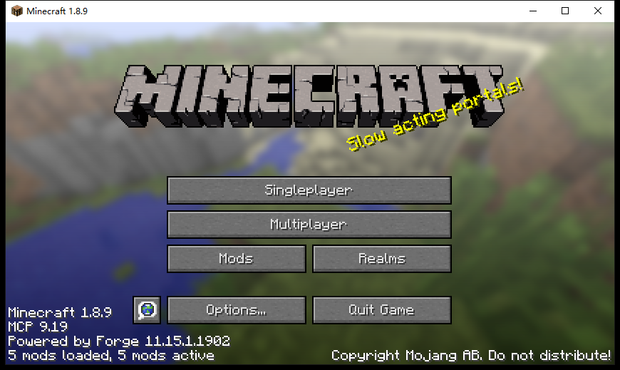
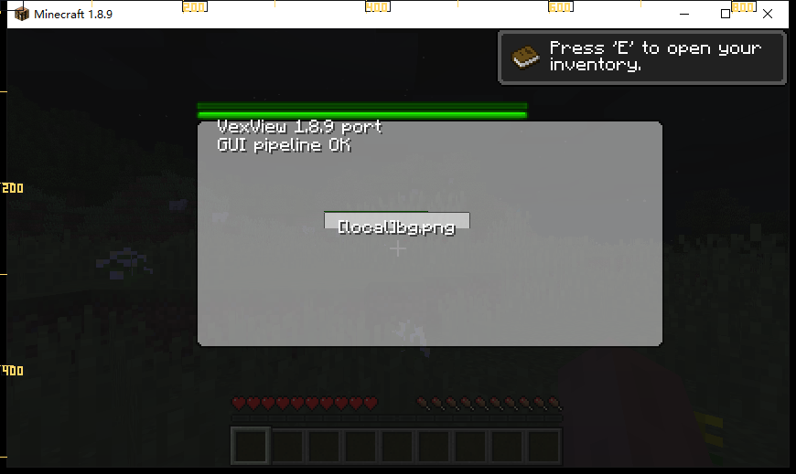
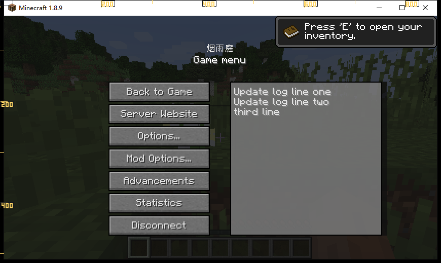

# VexView 2.7.3 · Minecraft 1.8.9 客户端

[](#兼容性)
[](#兼容性)
[](#构建)
[](#目录结构)
[](#验证)

把 **VexView 2.7.3**（原本只有 MC 1.12.2 的客户端模组）完整移植到 **Minecraft 1.8.9 + Forge**。
服务端继续使用官方 **VexView 2.7.3 Spigot 插件**，通信协议、配置文件、贴图目录、本地化 key 全部保持原样，
1.8.9 客户端可以直接连现有的 VexView 服务器。

> 本项目只是**移植**：模组逻辑、协议、美术资源都来自原作者。版权与致谢见 [致谢与版权](#致谢与版权)。

---

## 目录

- [为什么需要 1.8.9 版](#为什么需要-189-版)
- [功能](#功能)
- [安装](#安装)
- [兼容性](#兼容性)
- [截图](#截图)
- [构建](#构建)
- [验证](#验证)
- [已知差异与限制](#已知差异与限制)
- [目录结构](#目录结构)
- [常见问题](#常见问题)
- [致谢与版权](#致谢与版权)

---

## 为什么需要 1.8.9 版

1.8.9 仍是 PvP / 小游戏服务器最常用的版本之一，而官方 VexView 只维护到 1.12.2。
1.8.9 与 1.12.2 之间隔着 1.9 的战斗改动、1.11 的物品栈重构、1.12 的文本组件与 Forge 事件大改，
模组的 GUI / HUD / 计分板 / 聊天系统几乎全部要改，没法直接跑。

本移植逐项把这些差异对齐，并在**真实 1.8.9 客户端**里跑通了从「服务端数据包」到「屏幕上画出来」的完整链路。

## 功能

与原版 2.7.3 一致，服务端插件发的每一类数据包都已移植：

| 模块 | 说明 |
| --- | --- |
| 自定义 GUI | `gui` 包：背景贴图、文本、图片、GIF、MC 图片、Base64 图片、按钮、勾选框、输入框、多行文本域、滚动列表、物品槽、玩家/实体绘制 |
| HUD | 元素级增删改查（`hud` 包），支持相对布局与「超级 HUD」 |
| TAG / WorldTag | 世界内漂浮文字、图片、GIF 标签（`tag` / `worldtag` 包） |
| 计分板 | 完全自定义侧边栏（`scorebroad` 包），支持动态替换与关闭 |
| GameMenu | 替换原版 ESC 菜单，右侧带服务器公告/更新日志面板（`gamemenu` 包） |
| 公告 | 右上角滚动公告，`NORMAL / WARN / DOWNLOAD` 三种图标（`announce` 包） |
| 自定义药水 | 服务器下发的图标 + 名称 + 计时，显示在背包效果栏（`potion` 包） |
| 特效 | 闪电等屏幕特效（`effects` 包） |
| 聊天 | 频道化聊天界面、频道切换、聊天输入框美化（`ChatVexView` 频道） |
| 背包 / 物品预览 | 自定义背包 GUI、物品 Hover 预览、旋转物品展示、ToolTip 背景图 |
| 验证与自动连接 | 进服验证界面、断线重连、自动连接（`ver` 包） |
| 引导 | 首次进服的 VexView 引导教程（`guide` 包） |
| 动态更新 | 运行中热更新 HUD / 元素（`dynamic` 包） |
| 图片管线 | HTTP / 本地文件 / Base64 / GIF 四种来源，带缓存与失败提示 |

需要说明的是：`extra`（服务器下发物品动作）等全部数据包分派都在 `NetPacketManager` 里，未做删减。

## 安装

**客户端**

1. 安装 Minecraft **1.8.9** + **Forge 11.15.1.1902**（或同版本段的 1.8.9 Forge）。
2. 取 `vexview-2.7.3-1.8.9.jar`（[Releases](../../releases) 里下载，或按[构建](#构建)自行编译），放进 `.minecraft/mods/`。
3. 启动游戏，模组会自己生成 `config/vexview.cfg`（与原版同结构，可直接沿用 1.12.2 的配置）。

**服务端**

不需要装任何东西，继续用官方 **VexView 2.7.3 Spigot 插件**即可。
本地贴图放在客户端 `vexview/textures/`（可在 `config/vexview.cfg` 的 `imagepath.local_path` 里改），
插件端下发的 `[local]xxx.png` 会自动从该目录读取。

## 兼容性

| 项目 | 版本 |
| --- | --- |
| Minecraft | 1.8.9（1.8.x 理论可用，未逐一测试） |
| Forge | 1.8.9-11.15.1.1902（实际测试版本） |
| 服务端插件 | VexView 2.7.3（Spigot，协议不变） |
| 客户端模组 | 仅客户端；服务端与其它玩家不需要安装 |
| Java | 8 |

未测试：OptiFine 组合、其它 1.8.9 Forge 分支版本。

## 截图

**加载**（`5 mods loaded`，模组被 FML 正常识别）



**服务端下发的自定义 GUI**（背景贴图 + 文本元素 + 按钮元素，由服务器 `gui` 包驱动）



**GameMenu**：按钮走本地化文案，右侧是服务器公告/更新日志面板



## 构建

仓库自带完整工具链，**不需要 ForgeGradle**。要求：

* JDK **8**（`-JavaHome` 可显式指定，默认自动探测常见安装路径）
* 本机装过 **1.8.9**（或 1.8.9-Forge）—— 工具链会从 `.minecraft` 里取客户端 jar 和运行库
* 首次构建需要联网下载约 **4.5 MB** 的映射/AT 文件（mcp 的 `joined.srg`、`mcp_stable-22`、Forge `merged_at.cfg`），之后完全离线

```powershell
pwsh -File .\build-local.ps1
# 第一次会自动调用 build-tools\prepare-sdk.ps1 生成工具链，然后：
# -> build\libs\vexview-2.7.3-1.8.9.jar
```

`build-tools/prepare-sdk.ps1` 也可以单独运行（`-MinecraftDir <路径>` 指定别的 `.minecraft`，
`-Force` 强制重建），它做四件事：下载映射 → 用本机客户端 jar + Forge binpatch 生成 **MCP 命名空间的编译 SDK** →
生成 MCP→SRG 映射表 → 按本机库列表写 `cp.txt`。

流水线：`javac 1.8` → **MCP 成员名重写成 SRG**（Forge 1.8.9 运行期用的就是 SRG 名）→ 打包资源。

`build-tools/` 里是自建的三件套（源码可读，可复用）：

| 工具 | 作用 |
| --- | --- |
| `SdkBuilder.java` | vanilla 1.8.9 client jar → 应用 Forge binpatch → `joined.srg`（notch→SRG + MCP 类名）→ mcp_stable-22 → 应用 Forge AT，产出 MCP 命名空间的编译 SDK |
| `GenReobf189.java` | 由 `joined.srg` + CSV + SDK 生成 `mcp2srg-1.8.9.map`（24 843 条映射） |
| `Reobf.java` | **继承关系感知**的 MCP→SRG 重写器，并报告所有无法映射的成员 |

## 验证

完整报告：[`docs/VERIFICATION-1.8.9.md`](docs/VERIFICATION-1.8.9.md)

| 检查 | 结果 |
| --- | --- |
| 全量编译 | **0 error**，147 个源文件（146 个移植文件 + 1 个 compat 辅助类）→ **168 个 class**，与 1.12.2 基线类数完全一致 |
| MCP→SRG reobf | 13 593 处成员引用，**2 205 处改写**，0 处失败 |
| 未映射成员 | 仅 3 处，逐条确认为 Forge 追加方法 / `Iterable.iterator()`，本就不需要映射 |
| 实机加载 | 真实 1.8.9 客户端 `5 mods loaded`，preInit/init 全过，生成 `config/vexview.cfg` |
| 数据包链路 | 探针把与插件同格式的 `gzip(JSON)` 投进真实频道事件，走完「解压 → 分发 → 业务对象 → 渲染」 |
| 功能断言 | `gui`→`VexCustomGui` 正常打开并渲染；`gamemenu`→3 行公告解析成功；`potion`→`id=85` 的 `CustomPotion` 生效；`announce`→HUD 帧计数推进并按时消失 |
| 崩溃 | **0** |

实机测试过程中发现并修掉的两个真实缺陷（开发中，非上游遗留）：

1. **`ItemStack.EMPTY` 语义**：1.8.9 没有这个哨兵，批量迁移成 `null` 后 `ItemPickTools.m4` 会解引用空值，**打开任何带物品槽的 GUI 必崩**；已按原语义显式实现。
2. **语言文件名**：1.8.9 只认 `lang/en_US.lang` / `zh_CN.lang`（地区码大写），沿用 1.12.2 的小写名会让所有文案退化成 key。

此外与上游同步修复了反混淆遗留的 **“调用点密钥”字符串解密**（4 处）：它导致 GameMenu 右侧公告面板空白、`[local]` 本地贴图被当成 URL 去下载。

复现方式：

```powershell
pwsh -File .\probe\build-probe.ps1     # 构建验证探针（不随模组发布）
pwsh -File .\runtest.ps1              # 用 JDK8 直接拉起真实 1.8.9 客户端，探针自动进存档并投递数据包
```

## 已知差异与限制

移植的目标是“效果一致”，但 1.8.9 确实缺一部分 API，以下差异都是**等价替换或不可实现**，不是偷懒：

| 项 | 情况 |
| --- | --- |
| 1.9+ 新增实体 | `Evoker / Vindicator / Illusioner / Vex / Shulker / Parrot / PolarBear / Llama / EvokerFangs / AreaEffectCloud` 等 1.8.9 不存在，图鉴里不渲染；`Husk→Zombie`、`Stray/WitherSkeleton→Skeleton`、`ElderGuardian→Guardian`、`DragonFireball→LargeFireball`、各种马→`Horse` 做近似替代 |
| 自定义药水 | 1.8.9 注册表在 preInit 后冻结、且没有 `Potion(boolean,int)`，改为 preInit 预注册 32 良性 + 32 负面槽位，运行期只换图标/名字。同屏最多 64 种不同名自定义药水 |
| 药水 HUD 图标 | 1.8.9 没有 `Potion#renderHUDEffect`（原版只在背包里画效果），背包内效果条目照常显示自定义图标与计时 |
| 物品 ToolTip | 1.8.9 没有 `RenderTooltipEvent`，改为在各 GUI 的 `renderToolTip` 覆写里调用等价逻辑 |
| 平滑帧插值 | `Minecraft#getRenderPartialTicks()` 在 1.8.9 是私有字段，通过 Forge 的 `ObfuscationReflectionHelper` 读取，数值一致 |
| Boss 血条隐藏 | 1.8.9 只有 `BOSSHEALTH` 一个元素类型（无 `BOSSINFO`），功能保留 |
| 声音 | 1.8.9 没有 `SoundEvent/SoundEvents`，改用 `PositionedSoundRecord` + 同名声音资源 |

## 目录结构

```
src/main/java/            168 个类（lk.vexview.* + 内置 org.json），与 1.12.2 基线同构
src/main/resources/       assets、mcmod.info（mcversion 1.8.9）、pack.mcmeta（pack_format 1）
build-local.ps1           离线构建：javac → MCP→SRG reobf → 打包
build-tools/              自建 SDK / 映射 / reobf 工具链（prepare-sdk.ps1 一键生成，见“构建”）
probe/                    实机验证探针（不随模组发布）
runtest.ps1               拉起真实 1.8.9 Forge 客户端做端到端验证
docs/VERIFICATION-1.8.9.md  逐项验证报告
docs/evidence/            实机截图
```

## 常见问题

**Q：按钮/提示显示成 `goto.server.website` 这种 key？**
用本仓库构建的 jar（语言文件已按 1.8.9 规则改名）。自己改源码时记得 `assets/vexview/lang/` 必须是 `en_US.lang` / `zh_CN.lang`。

**Q：一打开带物品槽的 GUI 就崩？**
那是 `ItemStack.EMPTY` 语义问题，本仓库已修复（见 [验证](#验证)）。

**Q：服务端要不要装这个 mod？**
不要。服务端只装官方 VexView 2.7.3 Spigot 插件；这个 jar 是纯客户端模组。

**Q：能不能用在 1.12.2？**
1.12.2 请直接用官方模组；若要用源码构建，见下方[致谢与版权](#致谢与版权)里链接的上游反混淆仓库。

**Q：为什么构建脚本是 PowerShell？**
只是为了在 Windows 上一条命令跑完 `javac → reobf → jar`；核心逻辑都在 `build-tools/src/*.java`，换平台改成 shell 调用同样两个 Java 工具即可。

## 致谢与版权

* 原始模组 **VexView 2.7.3** © **LK520**、**lona**、**PluginsCDTribe** — <https://www.vexview.top/>
  模组逻辑、通信协议、贴图资源全部归原作者所有。
* 1.12.2 反混淆源码（本移植的起点）：<https://github.com/ysxiaoyu/VexView-Full-deobf>
* 反混淆与反编译工具：CFR 0.152、Vineflower、ASM。

本项目**只包含移植改动与构建/验证工具**，不包含任何 Minecraft 本体文件、不包含付费资源、不主张对原始代码的任何权利。
如果你是在维护已经使用 VexView 的服务器，本项目只是让这些服务器能在 1.8.9 上继续使用。
**若原作者对公开本项目有异议，联系后立即下架。**

本仓库自己的部分（`build-tools/`、`probe/`、`runtest.ps1`、文档）可自由参考与复用。

---

<details>
<summary>English summary</summary>

A port of the client-side **VexView 2.7.3** mod (originally MC 1.12.2) to **Minecraft 1.8.9 / Forge**.
The server keeps using the official VexView 2.7.3 Spigot plugin: packet formats, config layout, texture
folders and translation keys are unchanged, so a 1.8.9 client can join an existing VexView server.

* 147 source files → **168 classes**, **0 compile errors**, reobfuscated MCP→SRG (2 205 members).
* Verified in a real 1.8.9 client: FML loads the mod, and the full
  `packet → gzip → channel event → JSON dispatch → render` chain is exercised for
  `gui` / `hud` / `tag` / `scoreboard` / `gamemenu` / `announce` / `potion` / `effects`.
* The repo ships its own offline toolchain (SDK builder, mapping generator, hierarchy-aware reobf)
  plus a probe-based end-to-end test harness — no ForgeGradle required.
* Known 1.8.9 gaps (1.9+ entities, `Potion#renderHUDEffect`, `RenderTooltipEvent`, …) are documented
  in [已知差异与限制](#已知差异与限制) with their equivalents.

Not affiliated with the original authors. All mod logic © LK520 / lona / PluginsCDTribe.
Will be taken down on request from the authors.
</details>
